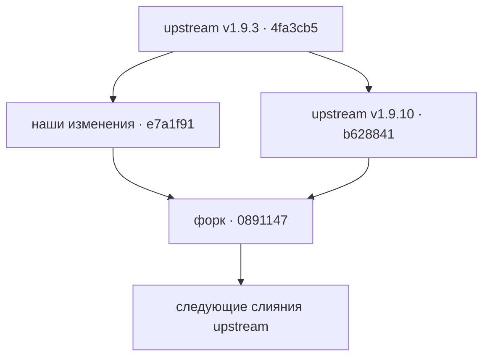

# Изменения форка и ориентиры для синхронизации

Этот файл относится к форку [`brake71/pi-ui-extension`](https://github.com/brake71/pi-ui-extension). Его цель — отличать наши изменения от новых коммитов [`1993yihuan/pi-ui-extension`](https://github.com/1993yihuan/pi-ui-extension) при следующем слиянии. Это описание **наших намерений и проверяемого поведения**, а не перечень всех отличий от upstream: часть кода в этих же файлах принадлежит автору основного репозитория.

## Откуда взялись изменения

- Исходная рабочая копия: `X:/pi/sessions`, базовый коммит upstream `4fa3cb5` (`v1.9.3`). В ней изменения были незакоммиченными.
- Снимок именно наших доработок: коммит `e7a1f91` (`local-session-work`), созданный из этой базы. Для поиска первоначальных правок: `git show e7a1f91`.
- При первом переносе upstream уже дошёл до `b628841` (`v1.9.10`). Коммит слияния `0891147` объединил обе ветки и разрешил пересечения. Для просмотра результата относительно upstream на тот момент: `git diff b628841..0891147 -- extensions/`.
- `origin` у этого клона — форк `brake71`, `upstream` — исходный репозиторий. Рабочая копия `X:/pi/sessions` **не** является источником будущих обновлений форка: она осталась на старой базе с теми же незакоммиченными изменениями.
- Версия `1.9.10` в `package.json` указывает на базовую версию upstream, **не** на отдельно опубликованный релиз наших доработок. Pi подключён к локальному каталогу `X:/pi/sessions-fork`, а не к npm-версии с тем же номером.

## Что мы добавили и что нужно сохранять

| Область | Наше поведение и его границы | Где искать и чем проверять |
| --- | --- | --- |
| Складная боковая панель | Панели «Сессии» и «Отображение» первоначально свёрнуты, «Контекст» раскрыт. Нажатие заголовка раскрывает/сворачивает панель; размеры пересчитываются при смене состояния и размера терминала. При сворачивании не должны срабатывать вложенные действия панели. | `extensions/sidebar/default-panels.ts`, `sidebar/index.ts`, `sidebar/registry.ts`; тесты `sidebar/default-panels.test.ts`, `sidebar/resize.test.ts`, `sidebar/render-cache.test.ts`. |
| Дочерние сессии | Каталог читает `parentSession` из заголовка JSONL и связывает родителя по пути **среди найденных сессий того же проекта**. Быстрый список не дублирует дочерние сессии и больше не ограничен пятью строками; список прокручивается. Менеджер показывает дочерние сессии под родителями, по умолчанию свернув группы; поиск учитывает потомков, доступны действия с выбранной дочерней сессией. | `extensions/session/catalog.ts`, `session/manager.ts`, `session/panel.ts`, `extensions/index.ts`; тесты `session/catalog.test.ts`, `session/manager.test.ts`, `session/panel.test.ts`. |
| Удаление на Windows | Вместо отсутствующей на Windows внешней команды `trash` используется PowerShell и системная корзина (`Microsoft.VisualBasic.FileIO`). Путь передаётся через закодированную команду; ошибки читаются из stderr или stdout. **Не** заменять это постоянным удалением и не обходить прежние проверки безопасности/подтверждение. На других платформах по-прежнему используется `trash`. | `extensions/session/mutations.ts`, `session/mutations.test.ts`, `session/safety.test.ts`, `session/bulk-integration.test.ts`. |
| Режим Hidden для инструментов | Собственные self-rendered строки инструментов скрываются **целиком** (`render()` возвращает `[]`), и их обработчик мыши выключен. Это меняет только отображение: выполнение, данные сессии и счётчики не затрагиваются. Не применять патч к чужим инструментам и не ломать Normal/Compact. | `extensions/tool-view/compact-spacing.ts`, `tool-view/compact-spacing.test.ts`, `tool-view/controller.test.ts`, `tool-view/host-bundle.test.ts`. |
| CTX и кэш | Панель показывает сумму токенов чтения и записи кэша вместе с hit rate; если строка узкая, метрика переносится на отдельную строку. Значения поступают из уже наблюдаемых показателей — это не точный подсчёт токенов провайдера. | `extensions/ctx/panel.ts`, `extensions/index.ts`, `extensions/sidebar/default-panels.ts`; тесты `ctx/panel.test.ts`, `sidebar/default-panels.test.ts`. |
| Переход между сессиями | `session_start` сбрасывает `switchRequested`: после успешного перехода старый флаг не должен блокировать переключения в новой сессии. | `extensions/index.ts`; проверять сценарии смены и перезагрузки сессии. |
| Русский интерфейс | Переведены видимые подписи панелей, названия действий, уведомления и сообщения диалогов/Tool View/MCP; тесты обновлены под русские строки. Сохранять смысл действий и статусов, а не копировать старые тексты. Перевод местами неполный, его не следует считать гарантией полной локализации. | `extensions/index.ts`, `ctx/panel.ts`, `dialogs/`, `mcp/`, `session/`, `sidebar/`, `tool-view/` и соседние `*.test.ts`. |

## Где уже пересекались с upstream

При слиянии `e7a1f91` с `b628841` конфликты были в `session/manager.ts`, `session/panel.ts`, `tool-view/controller.ts` и `tool-view/controller.test.ts`. Точное разрешение смотрите в `0891147` и последующих тестовых правках в этом merge-коммите. При следующей синхронизации важно сохранять **оба** намерения:

- **Менеджер сессий:** наше дерево и русские действия сосуществуют с upstream-блокировкой/атомарной записью закреплений, сохранением последнего успешного списка и обработкой ошибок повторной загрузки. Если закрепление уже сохранено, сбой обновления списка или боковой панели не должен сообщаться как ошибка записи закрепления.
- **Панель сессий:** наш полный прокручиваемый список и русские подписи сосуществуют с upstream-индикацией ошибки обновления и общими границами рисования/обработки кликов кнопок ресурсов (`resourceButtonSpans`). Строка ошибки не должна становиться кликабельной сессией; кнопки остаются на своих местах при любом числе строк.
- **Tool View:** upstream для поддерживаемых Pi 1.3+ убрал старый fallback `supportsThinking` и требует `registerMarkdownTransformer()`/`setHiddenThinkingLabel()`. Наши переводы не должны возвращать эту устаревшую ветку. Сохранять upstream-адаптер **реального CLI bundle** (`tool-view/host-bundle.ts`, `thinking-adapter.ts`): проверки только на SDK-классах недостаточны.
- **CTX/MCP:** новые upstream-правила учёта provider payload, сброса дельты CTX и валидации конфигурации MCP не являются нашей локализацией. При конфликте строк интерфейса сохранять их логику, включая `mcp/config-validation.ts`; отсутствие подтверждённого статуса адаптера не означает установленное соединение.

## Как синхронизировать следующий раз

1. `git fetch upstream main` в клоне форка; убедиться, что `git status --short` пуст. От `main` создать отдельную ветку синхронизации, например `git switch -c sync/upstream-next`.
2. Посмотреть новую сторону `git log --oneline main..upstream/main` и нашу сторону `git log --oneline upstream/main..main --no-merges`. Найти общую базу через `git merge-base main upstream/main`. Сверить функциональные изменения с таблицей выше и с `git show e7a1f91`, а не считать все изменения каждого файла исключительно нашими.
3. Выполнить `git merge upstream/main`. В конфликтах сохранять две цели по разделу выше; **не** выбирать целиком `ours` или `theirs` для больших файлов с переводом и логикой. При изменении текстов интерфейса обновлять ожидаемые строки в тестах.
4. Запустить `npm run typecheck`, `npm test`, `npm run check:docs` и `npm run check:package`; отдельно проверить интерактивное разворачивание панелей, прокрутку и клики в fullscreen Pi. На Windows под Node 24 `check:package` может падать ещё до проверки из-за `spawnSync npm.cmd EINVAL`: в этом случае выполнить `npm pack --dry-run --json --ignore-scripts` и передать список файлов в экспортированную `checkPackageFiles()` из `scripts/check-package.mjs`. Не считать ошибку запуска проверкой содержимого пакета.
5. Завершить merge-коммит, проверить итоговый diff и только затем обновлять `main` форка. Если изменились наши намерения, дополнить **этот файл** вместе с кодом; не переписывать исторические ссылки на `e7a1f91` и `0891147`.

Отправка коммитов в `origin` не отправляет их в `upstream`. Проверять адреса перед push: `git remote -v`.
